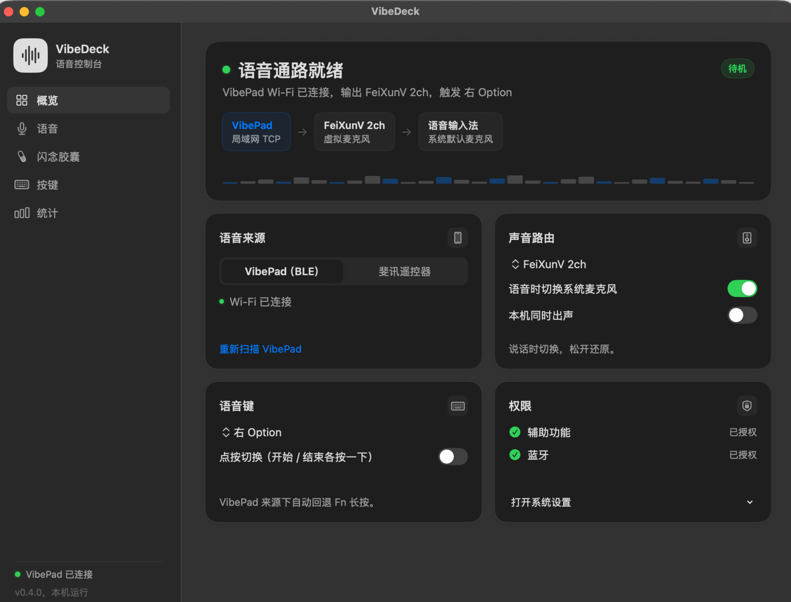

# FeiXunMai（VibeDeck）

**English** · [简体中文](README.zh-CN.md)

Turn a **Feixun T1/N1 Bluetooth voice remote** (RTL_618) into a wireless microphone and air mouse for the Mac — the same idea as [Wireless Mic SayAll](https://github.com/HD838A/remote-mic-app) and OpenAI × Work Louder's [Codex Micro](https://worklouder.cc/codex-micro): one push-to-talk key to drive an AI assistant, a handful of physical keys to drive the computer.

The app is about 1.5 MB and built entirely on Apple frameworks (Swift / AppKit / CoreBluetooth / AVFoundation), with no third-party Swift dependencies. The project owes a lot to remote-mic-app's public notes — see [Acknowledgements](#acknowledgements).



## Features

**Voice — hold to talk, release to stop**

- Audio arrives over the remote's BLE Kehwin private channel as mSBC 16 kHz, is decoded locally, and is routed into a virtual microphone.
- On voice start the app synthesizes an Fn hold (configurable: ⌘ / ⌥ / F5 / toggle) to open voice input in apps such as Doubao or WeChat Input.
- The system default input switches to the virtual mic for the duration of the call and is restored afterwards — remote voice and keyboard dictation do not fight over the same device.
- Ships **FeiXunV 2ch**, a virtual audio device with a USB transport type, so apps that filter out "virtual" devices (Doubao, for example) still list it.

**Keys**

- D-pad = mouse movement (hold to accelerate); OK = left click (hold to drag).
- Menu = Return; Back = Delete (hold to repeat); Home = Esc; OTT power = Paste ⌘V.
- Every key is remappable (Return / Esc / Delete / Copy / Paste / Left / Right / Mission Control / Lock Screen / Disabled).
- Volume keys pass through to macOS; TV power is infrared and never reaches the Mac.
- The remote's F5 HID echo is swallowed, so it never triggers system dictation or another voice tool.

**Other**

- Menu bar app plus the VibeDeck console (Overview / Voice / Capsules / Keys / Stats).
- Local stats only (today's voice count and duration), reset by date; nothing leaves the Mac.
- 30-second keepalive, subscription self-check, and sleep/wake recovery, so it still answers after hours on the desk.

## VibePad (Android phone)

The companion app (separate `vibepad/` project) turns a phone into a trackpad plus a
wireless microphone. The two links are independent:

- **trackpad** — the phone registers as a standard Bluetooth HID mouse/keyboard, so the
  Mac needs no client at all;
- **voice** — a dedicated BLE GATT service (`7A1B0001-…`) streams 8 kHz ADPCM, which the
  Mac decodes into FeiXunV 2ch.

Gestures:

| Gesture | Action |
|---|---|
| One-finger move / tap | Move pointer / left click |
| Two-finger swipe | Scroll (natural direction, matching macOS) |
| Two-finger tap | Right click |
| Hold still ~0.35 s, then move | Press and drag (no double-tap drag) |
| Two-finger horizontal | Scroll sideways |
| Edge scroll | Same side as the holding hand, mirrored for left-handed use |

Control bar: `确认` = Enter (send / allow a permission prompt), `打断` = Esc (interrupt the
current generation), `胶囊` = hold to record an idea capsule, `删除` / `切换` send Backspace /
Cmd+Tab, plus a hold-to-talk key. Right-handed layout is `[voice][confirm][interrupt]`;
left-handed mirrors it.

Measured voice-path facts:

- the BLE link carries about **4 KB/s** (macOS settles on a 50–60 ms connection interval
  and one packet per event), so the wire format is 8 kHz / 40 ms / 160 B ADPCM at
  25 packets/s — just inside the budget, with no loss;
- capture uses `VOICE_COMMUNICATION` (system AGC + noise suppression);
  `VOICE_RECOGNITION` is attenuated to −43 dBFS on MIUI and is unusable;
- every session switches the system default input **before** pressing the trigger key
  (input methods grab the device at that instant) and then **rebuilds the AudioSink**,
  because changing the default input invalidates the old output binding — the engine
  keeps running with a live mixer level while the virtual device receives nothing.

Diagnostics: all voice events go to `~/Library/Logs/VibeDeck.log`; the developer buttons
(“麦克风自检 / 回环自检 1kHz / 录虚拟麦”) are hidden by default — enable them with
`defaults write com.feixun.mai showDiagnostics -bool true` and relaunch.

## Requirements

- Mac with Apple Silicon or Intel, macOS 13 or later.
- An Android phone (Android 9+) with VibePad, or a Feixun T1/N1 original remote.
- Wi-Fi voice and capsule sync need the phone and Mac on the same LAN (Bluetooth voice does not).
- Remote pairing: hold **Home + Volume Down** together, then connect from System Settings → Bluetooth.

## Install and first run

1. Install VibeDeck: unzip / mount the dmg, drag `VibeDeck.app` into Applications.
2. Install the virtual audio driver: double-click `FeiXunV2ch-driver.pkg` from the release, then run `sudo killall coreaudiod` (or reboot); `FeiXunV 2ch` should appear in System Settings → Sound.
3. Launch VibeDeck and grant Accessibility (synthesized voice key + focus restore), Bluetooth, Microphone (diagnostics only) and Local Network (macOS 15+, Bonjour and capsule sync).
4. Install VibePad: copy `VibePad-0.5.0.apk` to the phone (allow unknown sources) and grant Nearby devices / Microphone / Notifications.
5. Pair `VibePad Trackpad` in system Bluetooth first, then open VibePad; choose Bluetooth or Wi-Fi for the voice link.
6. Doubao: install the Doubao IME, enable it under Keyboard → Input Sources, grant microphone access, and keep VibeDeck's voice key on the default Right Option.

## How it works

```
voice key ─┬─ GATT 07fc01/07fc07 + mSBC stream → libsbc decode → 0.4 s gate (drops tap glitches)
           │                                      → drain buffer → FeiXunV/BlackHole virtual mic
           └─ HID F5 echo (swallowed in synthesized mode)
voice start ─┬─ synthesize Fn down (release +0.35 s after the buffer drains)
             └─ system default input → virtual mic; restore the real mic on release
other keys ─── HID report-layer "arm, then suppress": only the remote (VID 0x005D) is intercepted,
                identical key codes from a real keyboard always pass through
```

VibePad voice reuses the same decode → gate → key timing with BLE ADPCM or Wi-Fi PCM as the source.
Capsule transcription reuses the same audio and key path, replaying a recorded WAV instead of live audio.

More design notes and measurements live in [docs/](docs/):
[key design](docs/按键设计.md) ·
[remote capabilities](docs/遥控器能力摸底.md) ·
[comparison](docs/对标梳理.md) ·
[lessons learned](docs/经验教训.md) ·
[HID verification plan](docs/HID验证计划.md)

## Known limitations and fixes

**1. "Cannot verify the developer" on first launch**
- Right-click `VibeDeck.app` → Open, or run `xattr -dr com.apple.quarantine /Applications/VibeDeck.app`.
- The release is not notarized (no Apple Developer account); this is expected.

**2. FeiXunV 2ch is missing**
- Check `ls /Library/Audio/Plug-Ins/HAL/FeiXunV2ch.driver`;
- run `sudo killall coreaudiod` or reboot;
- fallback: BlackHole 2ch (`brew install blackhole-2ch`), but Doubao may filter it as a virtual device; FeiXunV's USB transport is what Doubao accepts reliably.

**3. Doubao produces no text / capsules stay pending**
- Doubao must be the current input source (selected in the menu bar) with microphone permission;
- VibeDeck's voice key must match Doubao's (default Right Option; change it on the Voice page);
- keep "switch system microphone during voice" enabled;
- use "Transcribe now" on a capsule and watch the HUD at the top of the screen;
- if still empty, hold "Hold to talk" on the phone to verify the voice path, then check whether Accessibility permission was revoked;
- automatic transcription stops after 3 failed attempts to avoid stealing focus; retry manually after fixing Doubao.

**4. Phone stuck on "voice waiting" / cannot connect**
- Pair the HID device in system Bluetooth before opening the app;
- MIUI: enable Autostart for VibePad, set battery saver to "No restrictions", keep the notification;
- use only one voice transport at a time (Bluetooth or Wi-Fi), switch it in the phone settings;
- the app relies on its foreground service; do not force-stop it.

**5. Wi-Fi voice / capsule sync cannot connect**
- phone and Mac must be on the same LAN with AP isolation disabled;
- allow mDNS/Bonjour (UDP 5353) and TCP 59321;
- allow VibeDeck through the macOS firewall; macOS 15 asks for Local Network access on first use;
- the Mac must be awake; the phone reconnects automatically after wake.

**6. MCP tools do not appear**
- configure the absolute path from `docs/MCP-CLIENTS.md` and restart the client;
- Claude Code / Codex / Qwen Code can use their built-in `mcp add`;
- Qoder / DeepSeek Harness need a manual stdio entry in their settings; Cursor is not supported;
- smoke test: `python3 -I scripts/test-mcp.py dist/VibeDeckMCP`.

**7. Stats scope**
- Stats count voice sessions only (phone push-to-talk, remote); capsule transcription and playback are not included;
- values reset by date and stay on this Mac.

**8. Three-finger gestures**
- Not supported: MIUI claims three-finger touches for screenshots before the app sees them; the code and UI hint were removed.

**9. APK install/upgrade**
- The APK is self-signed; upgrading from a debug build or a differently signed build fails with a signature mismatch — uninstall first;
- future builds use the same local release key (not committed).

**11. Remote firmware**
- While the voice key is held, Back/Home/Menu do not respond (the firmware pauses key reports during streaming and recovers on release).
- If the remote stops responding, pull the battery and reinsert it.
- Modifier triggers (⌘/⌥) can collide with app shortcuts; Fn is the safest default.

**10. Privacy**
- Audio, transcripts and stats stay local; the MCP server only reads local files.

## Privacy

Voice and capsule sync stay on this Mac and the local network; nothing is uploaded. Settings and statistics live in local UserDefaults.

## License and acknowledgements

- Project code: MIT — see [LICENSE](LICENSE).
- [BlackHole](https://github.com/ExistentialAudio/BlackHole) by Existential Audio: FeiXunV 2ch and BlackHole 2ch are modified builds of v0.7.1, licensed **GPL-3.0**. Modified source is in [driver/BlackHole-0.7.1](driver/BlackHole-0.7.1/).
- [google/libsbc](https://github.com/google/libsbc): mSBC decoding (Apache-2.0).

**Special thanks to [Wireless Mic SayAll (HD838A/remote-mic-app)](https://github.com/HD838A/remote-mic-app).** The product idea, the arm-then-suppress HID architecture, the "trigger follows the audio stream, not the key event" timing, the audio wiring order that fixed our silent virtual mic, and much of the debugging map came from its public documentation and its 343-entry bug archive. If this project helps you, give SayAll a star too.


## Building from source

macOS 13+ with Xcode Command Line Tools:

```bash
./scripts/build-app.sh
# outputs: dist/VibeDeck.app, dist/VibeDeck-0.5.0.zip / .dmg, dist/VibeDeckMCP
```

The Android app needs JDK 21 and the Android SDK:

```bash
cd vibepad
echo "sdk.dir=/path/to/Android/sdk" > local.properties
./gradlew assembleDebug
# output: app/build/outputs/apk/debug/app-debug.apk
```

## Idea Capsules (VibePad)

Hold the **Capsule** key on the phone, say a thought, release: the phone records a WAV locally.
When connected, it uploads over a dedicated Wi-Fi channel. Once the Mac has had about 8 seconds
without keyboard or mouse input, it transcribes automatically: switch the default input, rebuild
the virtual audio sink, hold the voice key, play the recording into FeiXunV, and let Doubao type
the text into a small HUD panel. The text is written back to the capsule and pushed to the phone.

If you touch the keyboard or mouse during transcription it aborts immediately, keeps the capsule
pending, and restores focus. The Mac's Capsules page is a sticky-note grid with manual transcription
and a folder shortcut. A read-only MCP server exposes the capsules to agents.
