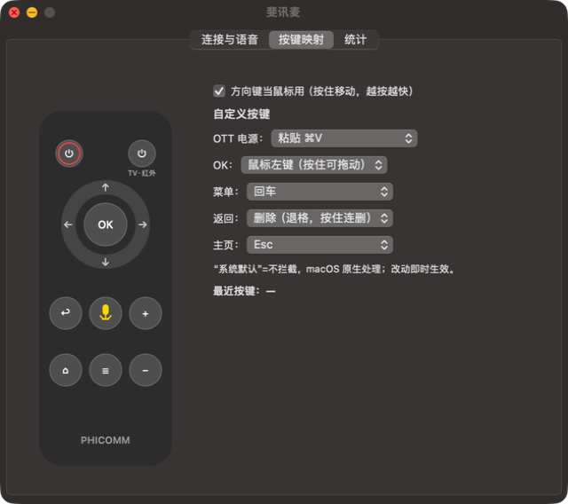

# FeiXunMai（斐讯麦）

**English** · [简体中文](README.zh-CN.md)

Turn a **Feixun T1/N1 Bluetooth voice remote** (RTL_618) into a wireless microphone and air mouse for the Mac — the same idea as [Wireless Mic SayAll](https://github.com/HD838A/remote-mic-app) and OpenAI × Work Louder's [Codex Micro](https://worklouder.cc/codex-micro): one push-to-talk key to drive an AI assistant, a handful of physical keys to drive the computer.

The whole installer is about 300 KB and built entirely on Apple frameworks (Swift / AppKit / CoreBluetooth / AVFoundation), with no third-party Swift dependencies. The project owes a lot to remote-mic-app's public notes — see [Acknowledgements](#acknowledgements).



## Features

**Voice — hold to talk, release to stop**

- Audio arrives over the remote's BLE Kehwin private channel as mSBC 16 kHz, is decoded locally, and is routed into a virtual microphone.
- On voice start the app synthesizes an Fn hold (configurable: ⌘ / ⌥ / F5 / toggle) to open voice input in apps such as Doubao or WeChat Input.
- The system default input switches to the virtual mic for the duration of the call and is restored afterwards — remote voice and keyboard dictation do not fight over the same device.
- Ships **FeiXunV 2ch**, a virtual audio device with a USB transport type, so apps that filter out "virtual" devices (Doubao, for example) still list it.

**Keys**

- D-pad = mouse movement (hold to accelerate); OK = left click (hold to drag).
- Menu = Return; Back = Delete (hold to repeat); Home = Esc; OTT power = Paste ⌘V.
- Every key is remappable (Return / Esc / Delete / Copy / Paste / Left / Right / Mission Control / Lock Screen / Disabled).
- Volume keys pass through to macOS; TV power is infrared and never reaches the Mac.
- The remote's F5 HID echo is swallowed, so it never triggers system dictation or another voice tool.

**Other**

- Menu bar app with a native AppKit settings window.
- Local stats only (voice count and duration); nothing leaves the Mac.
- 30-second keepalive, subscription self-check, and sleep/wake recovery, so it still answers after hours on the desk.

## Requirements

- Mac with Apple Silicon or Intel, macOS 13 or later.
- A Feixun T1/N1 original remote (HID + Kehwin service 1920).
- Pairing: hold **Home + Volume Down** together, then connect from System Settings → Bluetooth.

## Install

1. Download `斐讯麦安装包-0.3.0.pkg` from [Releases](../../releases/latest). It contains the app, the FeiXunV 2ch driver, and BlackHole 2ch.
2. The package is not notarized. Right-click it and choose **Open**; if macOS still blocks it, allow it under System Settings → Privacy & Security.
3. Grant Bluetooth permission.
4. In your voice app, set the microphone to **Automatic / Follow system default** (do not pin a specific device).
5. Hold the remote's voice key and talk. Grant Accessibility permission only if you use Fn emulation.

Build from source:

```zsh
./scripts/build-app.sh   # produces dist/FeiXunMai.app, zip, dmg and the combined pkg
```

## How it works

```
voice key ─┬─ GATT 07fc01/07fc07 + mSBC stream → libsbc decode → 0.4 s gate (drops tap glitches)
           │                                      → drain buffer → FeiXunV/BlackHole virtual mic
           └─ HID F5 echo (swallowed in synthesized mode)
voice start ─┬─ synthesize Fn down (release +0.35 s after the buffer drains)
             └─ system default input → virtual mic; restore the real mic on release
other keys ─── HID report-layer "arm, then suppress": only the remote (VID 0x005D) is intercepted,
                identical key codes from a real keyboard always pass through
```

More design notes and measurements live in [docs/](docs/):
[key design](docs/按键设计.md) ·
[remote capabilities](docs/遥控器能力摸底.md) ·
[comparison](docs/对标梳理.md) ·
[lessons learned](docs/经验教训.md) ·
[HID verification plan](docs/HID验证计划.md)

## Known limitations

- While the voice key is held, Back/Home/Menu do not respond (the firmware pauses key reports during streaming; they recover on release).
- If the remote stops responding, pull the battery and reinsert it — a known RTL_618 firmware issue.
- Modifier triggers (⌘/⌥) can collide with app shortcuts; Fn is the safest default.

## Privacy

No network access, no uploads. Audio is decoded and routed locally; statistics stay in local UserDefaults.

## License and acknowledgements

- Project code: MIT — see [LICENSE](LICENSE).
- [BlackHole](https://github.com/ExistentialAudio/BlackHole) by Existential Audio: FeiXunV 2ch and BlackHole 2ch are modified builds of v0.7.1, licensed **GPL-3.0**. Modified source is in [driver/BlackHole-0.7.1](driver/BlackHole-0.7.1/).
- [google/libsbc](https://github.com/google/libsbc): mSBC decoding (Apache-2.0).

**Special thanks to [Wireless Mic SayAll (HD838A/remote-mic-app)](https://github.com/HD838A/remote-mic-app).** The product idea, the arm-then-suppress HID architecture, the "trigger follows the audio stream, not the key event" timing, the audio wiring order that fixed our silent virtual mic, and much of the debugging map came from its public documentation and its 343-entry bug archive. If this project helps you, give SayAll a star too.
