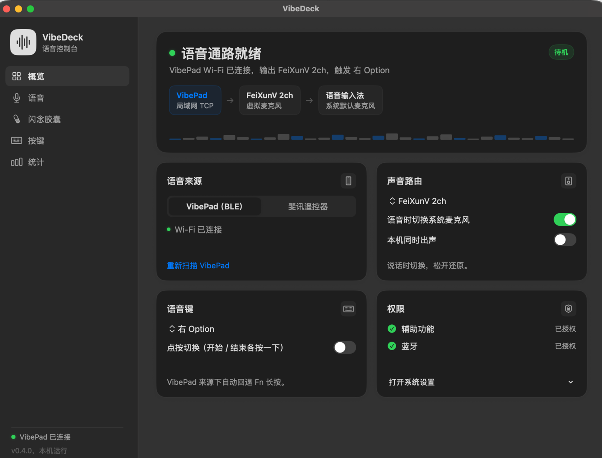

# VibeDeck（FeiXunMai）

> Mac 端显示名已从“斐讯麦”改为 **VibeDeck**；手机端为 **VibePad**。内部可执行文件和 bundle id 保留 `FeiXunMai` / `com.feixun.mai`，避免重新授权辅助功能与蓝牙。


[English](README.md) · **简体中文**

把 **斐讯 T1/N1 蓝牙语音遥控器**（RTL_618 方案）变成 Mac 的无线麦克风 + 空气鼠标，
对标 [无线麦 SayAll（remote-mic-app）](https://github.com/HD838A/remote-mic-app) 与
OpenAI × Work Louder 的 [Codex Micro](https://worklouder.cc/codex-micro) 的思路：
**一个语音键指挥 AI，几个实体键控制电脑**。

安装包约 1.5 MB，纯苹果原生技术栈（Swift / AppKit / CoreBluetooth / AVFoundation），
无任何第三方 Swift 依赖。本项目深受 [无线麦 SayAll（remote-mic-app）](https://github.com/HD838A/remote-mic-app)
启发，多项关键设计直接参考其公开文档与踩坑记录（见下方致谢）。



## 功能

**语音（按住说话，松开结束）**
- 遥控器语音经 BLE Kehwin 私有协议推送 mSBC 16 kHz 音频，本机解码后送入虚拟麦克风；
- 语音开始时自动合成 Fn 长按（可换 ⌘/⌥/F5 直连/点按切换），拉起豆包、微信输入法等语音入口；
- 语音期间系统默认输入自动切到虚拟麦克风，松开自动还原——**遥控器语音与键盘语音互不干扰**；
- 自带豆包专属虚拟声卡 **FeiXunV 2ch**（USB transport，豆包可自动识别）。

**按键**
- 方向键 = 鼠标移动（按住加速）；OK = 鼠标左键（按住可拖动）；
- 菜单 = 回车；返回 = 删除（按住连删）；主页 = Esc；OTT 电源 = 粘贴 ⌘V；
- 全部可在界面重映射（回车 / Esc / 删除 / 复制 / 粘贴 / 左右键 / 调度中心 / 锁屏 / 屏蔽）；
- 音量键走系统直通；TV 电源为红外，不经过 Mac；
- 语音键的 F5 回声自动吞掉，不会误触系统听写或其他语音工具。

**其他**
- 菜单栏常驻 + VibeDeck 控制台（概览 / 语音 / 闪念胶囊 / 按键 / 统计）；
- 本地统计（今日语音次数/时长），按日期自动重置，不上传任何数据；
- 语音通道 30 秒保活 + 订阅自检 + 睡眠唤醒自愈，长期待机也能即按即说。

## VibePad（Android 手机端）

配套 App（独立工程 `vibepad/`），把手机变成触控板 + 无线麦克风。两个连接互相独立：

- **触控板**：手机注册为标准蓝牙 HID 鼠标/键盘，Mac 端零客户端；
- **语音**：手机自建 BLE GATT 服务（`7A1B0001-…`），音频经 8 kHz ADPCM 送到 Mac，
  解码后写入 FeiXunV 2ch。

手势：

| 手势 | 行为 |
|---|---|
| 单指移动 / 轻点 | 移动指针 / 左键 |
| 双指滑动 | 滚动（自然滚动，方向与 macOS 一致） |
| 双指轻点 | 右键 |
| 按住不动约 0.35 s 再移动 | 按下左键拖动（不做双击拖动） |
| 双指横向 | 左右滚动 |
| 边缘滚动 | 与持机手同侧，左右手镜像 |

控制条：`确认` = Enter（发送 / 允许权限），`打断` = Esc（中断生成），`胶囊` = 按住录一条闪念，
`删除` / `切换` 分别发送 Backspace / Cmd+Tab；语音键按住说话。右手模式为 `[语音键][确认][打断]`，
左手整体镜像。

**闪念胶囊**

- 手机端按住「胶囊」只录音，松手存本地 WAV；连上 Mac 后走独立的 Wi-Fi 同步通道上传；
- Mac 连续约 8 秒没有键鼠输入时自动转写：切系统默认输入 → 重建虚拟声卡 → 按住语音键，
  把录音播进 FeiXunV，由豆包把文字打进顶部小窗，再写回胶囊并同步给手机；
- 转写期间检测到真实键鼠输入会立刻中断并回滚，胶囊保持待转写，不抢用户焦点；
- Mac 的胶囊页是便签网格，可查看/手动转写/打开存储目录；另附只读 MCP 服务供 Agent 读取。

语音链路的实测硬指标：

- BLE 链路吞吐约 **4 KB/s**（macOS 把连接间隔放在 50~60 ms，每周期只发一个包），
  所以线上格式定为 8 kHz / 40 ms / 160 B ADPCM、25 包/秒，刚好不丢包；
- 手机采集用 `VOICE_COMMUNICATION`（系统 AGC + 降噪）；`VOICE_RECOGNITION` 在 MIUI 上
  会被衰减到 -43 dBFS，等于静音；
- 每次语音开始时**先切系统默认输入、再按触发键**（输入法在按键瞬间取设备），
  且切换后必须**重建 AudioSink**——切默认输入会让旧输出绑定失效，表现为
  "引擎 running、mixer 有电平，但虚拟声卡收不到"。

诊断：Mac 端语音事件全部写入 `~/Library/Logs/VibeDeck.log`；界面「声音路由」卡片里有
「麦克风自检」「回环自检 1kHz」「录虚拟麦」三个按钮，可逐段验证链路。

## 硬件与系统要求

- Mac（Apple Silicon / Intel），macOS 13+；
- 斐讯 T1/N1 原装遥控器（`斐讯遥控器`，HID + Kehwin 1920 服务）；
- 配对方式：同时长按 **主页 + 音量减**，在系统蓝牙里连接。

## 安装

1. 从 [Releases](../../releases/latest) 下载 `FeiXunMai-0.3.0.pkg`（内含 VibeDeck.app + FeiXunV 2ch + BlackHole 2ch 两个虚拟声卡）；
2. 安装包未做签名公证：右键点安装包选「打开」；若仍被拦，去「系统设置 → 隐私与安全性」放行；
3. 允许「蓝牙」权限；
4. 语音应用的麦克风设为 **“自动 / 跟随系统默认”**（不要固定选某个设备）；
5. 按住遥控器语音键说话即出字；需要 Fn 模拟时再授予「辅助功能」权限。

构建（可选，从源码）：

```zsh
./scripts/build-app.sh    # 产出 dist/VibeDeck.app、zip、dmg 和总安装包 pkg
```

## 工作原理

```
遥控器语音键 ─┬─ GATT 07fc01/07fc07 + mSBC 音频流 → libsbc 解码 → 0.4s 门槛（滤掉点按毛刺）
              │                                      → 缓冲排空 → FeiXunV/BlackHole 虚拟麦克风
              └─ HID F5 回声（合成模式下吞掉）
语音开始 ────┬─ 合成 Fn 按下（结束 +0.35s 排空后松开）
             └─ 系统默认输入 → 虚拟麦克风；松开后还原真实麦克风
其余按键 ─────  HID 报告层"布防-拦截"：只处理遥控器（VID 0x005D）的键，
                真键盘的同键码按键永远直通
```

更多设计与实测数据见 [docs/](docs/)：
[按键设计](docs/按键设计.md) ·
[遥控器能力摸底](docs/遥控器能力摸底.md) ·
[对标梳理](docs/对标梳理.md) ·
[经验教训](docs/经验教训.md) ·
[HID 验证计划](docs/HID验证计划.md)

## 已知限制

- 按住语音键说话期间，返回/主页/菜单暂不响应（固件在推流时暂停消费键上报，松开即恢复）；
- 遥控器固件偶发按键无响应时，扣电池重装即可恢复（RTL_618 固件已知问题）；
- 语音触发键若使用修饰键（⌘/⌥）可能与目标应用快捷键冲突，默认 Fn 一般最稳。

## 隐私

不联网、不上传；语音只在本地解码转发，统计只存本机 UserDefaults。

## 许可与致谢

- 本项目代码：MIT（见 [LICENSE](LICENSE)）；
- [BlackHole](https://github.com/ExistentialAudio/BlackHole)（Existential Audio）：
  FeiXunV 2ch / BlackHole 2ch 虚拟声卡基于其 v0.7.1 修改，遵循 **GPL-3.0**，
  修改后源码见 [driver/BlackHole-0.7.1](driver/BlackHole-0.7.1/)；
- [google/libsbc](https://github.com/google/libsbc)：mSBC 解码（Apache-2.0）。

### 特别致谢：[无线麦 SayAll（HD838A/remote-mic-app）](https://github.com/HD838A/remote-mic-app)

本项目从立项到实现都受益于该项目的公开资料，包括但不限于：

- **立项灵感**："把蓝牙语音遥控器变成 Mac 的 vibe coding 语音入口"这一产品形态
  与其能力矩阵（遥控器 × 输入工具收音模式对照）直接来自该项目的公开文档；
- **HID 布防-拦截架构**：本项目的按键拦截移植自其
  `KeyboardEventSuppressor` 的 arm-then-suppress 设计，解决了
  "遥控器按键与真键盘同键码冲突"的问题；
- **语音触发时序**："触发键跟随音频流而非按键事件、结束等排空（draining）"
  的设计来自其 `VoiceFnTapSessionController`；
- **音频接线顺序与虚拟设备可听性修复**：`AudioOutput` 的
  "只连 player→mixer、先选设备再启动"是本项目音频静音问题的解药；
- **踩坑地图**：其 Bugs/ 目录的 343 条记录帮助我们提前规避了
  虚拟音频阻止休眠、音频通道假活、HID 客户端生命周期等多类问题，
  并提示了豆包需要专属 USB transport 虚拟声卡的方向。

如果本项目对你有用，也请给 [无线麦 SayAll](https://github.com/HD838A/remote-mic-app) 一个 Star。


## 安装与首次配置

1. 安装 VibeDeck：解压 zip / 挂载 dmg，把 `VibeDeck.app` 拖进 Applications。
2. 安装虚拟声卡：双击 Release 里的 `FeiXunV2ch-driver.pkg`，装完执行 `sudo killall coreaudiod`（或重启），在「系统设置 → 声音」里应能看到 `FeiXunV 2ch`。
3. 打开 VibeDeck，按提示授予：辅助功能（合成语音键、恢复焦点）、蓝牙、麦克风（仅诊断自检需要）、本地网络（macOS 15+，Bonjour 与胶囊同步）。
4. 安装 VibePad：把 `VibePad-0.5.0.apk` 传到手机安装（允许未知来源），授予附近设备 / 麦克风 / 通知权限。
5. 配对：先在系统蓝牙里配对 `VibePad Trackpad`，再打开 VibePad；手机端语音链路选蓝牙或 Wi-Fi。
6. 豆包：安装豆包输入法 → 系统设置 → 键盘 → 输入法中添加并切换到豆包 → 授权麦克风；VibeDeck 里语音键保持默认「右 Option」。

## 已知限制与解决办法

**1. 首次打开提示“无法验证开发者”**
- 右键 `VibeDeck.app` → 打开；或 `xattr -dr com.apple.quarantine /Applications/VibeDeck.app`。
- Release 未做 Apple 公证（没有开发者账号），属预期。

**2. 声音设置里没有 FeiXunV 2ch**
- 确认驱动已安装：`ls /Library/Audio/Plug-Ins/HAL/FeiXunV2ch.driver`；
- 执行 `sudo killall coreaudiod` 或重启；
- 仍没有：可临时用 BlackHole 2ch（`brew install blackhole-2ch`），但豆包可能把它当“虚拟设备”过滤，FeiXunV 的 USB transport 才能稳定被识别。

**3. 豆包不出字 / 胶囊一直“待转写”**
- 豆包输入法必须是当前输入法（菜单栏输入法选中豆包），且已授予麦克风；
- VibeDeck 的语音键要和豆包语音键一致（默认右 Option，可在「语音」页改）；
- 「语音时切换系统麦克风」保持开启；
- 手动点胶囊上的「立即转写」，屏幕顶部会出现 HUD 小窗，观察是否出字；
- 仍不出字：先按住手机「按住说话」验证语音链路（豆包应能出中文），再检查辅助功能权限是否被系统撤销；
- 自动转写失败 3 次后会停止重试，避免反复抢焦点；处理完豆包后手动转写。

**4. 手机端“语音等待”/ 连不上**
- 先在系统蓝牙配对 HID，再打开 App；
- 小米/红米：设置 → 应用 → VibePad → 自启动打开、省电策略“无限制”，通知常驻不要划掉；
- 语音链路只保留一种：蓝牙或 Wi-Fi，在手机设置里切换；
- App 依赖前台服务常驻，勿强行停止。

**5. Wi-Fi 语音 / 胶囊同步连不上**
- 手机与 Mac 必须在同一局域网，路由器关闭 AP 隔离；
- 允许 mDNS/Bonjour（UDP 5353）与 TCP 59321；
- macOS 防火墙放行 VibeDeck；macOS 15 首次会弹“本地网络”权限，必须允许；
- Mac 睡眠时连不上，唤醒后手机端会自动重连，也可重开 App。

**6. MCP 工具不出现**
- 按 `docs/MCP-CLIENTS.md` 填绝对路径并重启客户端；
- Claude Code / Codex / Qwen Code 可用自带 `mcp add`；
- Qoder / DeepSeek Harness 在应用设置里手动加 stdio 命令；Cursor 未支持；
- 自测：`python3 -I scripts/test-mcp.py dist/VibeDeckMCP`。

**7. 统计口径**
- 「统计」只统计语音会话次数和时长（手机按住说话、遥控器），不包含胶囊转写/回放；
- 数据按日期自动重置，只存本机。

**8. 三指手势**
- 不支持：MIUI 会把三指触摸当截图手势拦截，App 收不到完整事件，相关代码和界面提示已移除。

**9. APK 安装/升级**
- APK 使用自签名证书；从旧 debug 包或别人签名的包升级会提示签名冲突，需先卸载再装；
- 后续版本会用同一把发布密钥签名（密钥不进仓库）。

**10. 隐私**
- 录音、转写文本、统计都只在本机；MCP 只读本地目录，不上传。

## 从源码构建

macOS 13+，安装 Xcode Command Line Tools：

```bash
./scripts/build-app.sh
# 产物：dist/VibeDeck.app、dist/VibeDeck-0.5.0.zip / .dmg、dist/VibeDeckMCP
```

Android 端需要 JDK 21 + Android SDK：

```bash
cd vibepad
echo "sdk.dir=/path/to/Android/sdk" > local.properties
./gradlew assembleDebug
# 产物：app/build/outputs/apk/debug/app-debug.apk
```

## 闪念胶囊 MCP

Mac 端自带一个只读 MCP 服务器，把手机同步过来的闪念胶囊交给 Agent：

```bash
# 可执行文件
dist/VibeDeckMCP
```

工具：`list_capsules`（最近胶囊，可只看待转写）、`search_capsules`（按关键词搜索转写文本）、`get_capsule`（按 id 取完整文本与音频路径）。

客户端配置示例：

```json
{
  "mcpServers": {
    "vibedeck-capsules": {
      "command": "/绝对路径/feixunmai/dist/VibeDeckMCP",
      "args": []
    }
  }
}
```

自测：`python3 -I scripts/test-mcp.py dist/VibeDeckMCP`。详细说明见 `docs/MCP.md`。

接入各种 Agent（ZCode / Claude Code / Codex / Qwen Code / WorkBuddy）的配置见 `docs/MCP-CLIENTS.md`。
